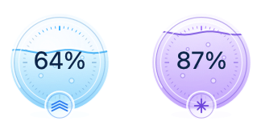
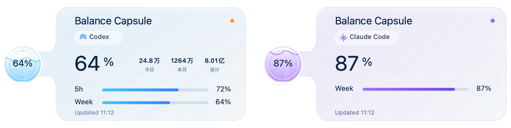
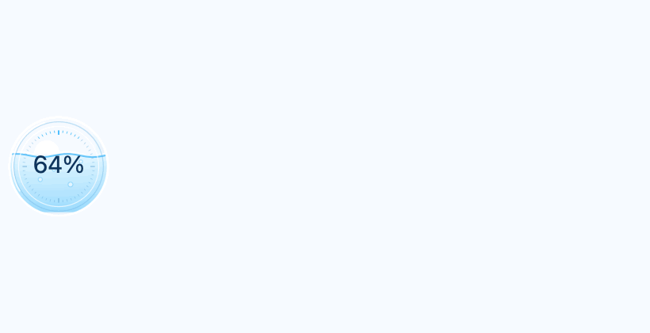
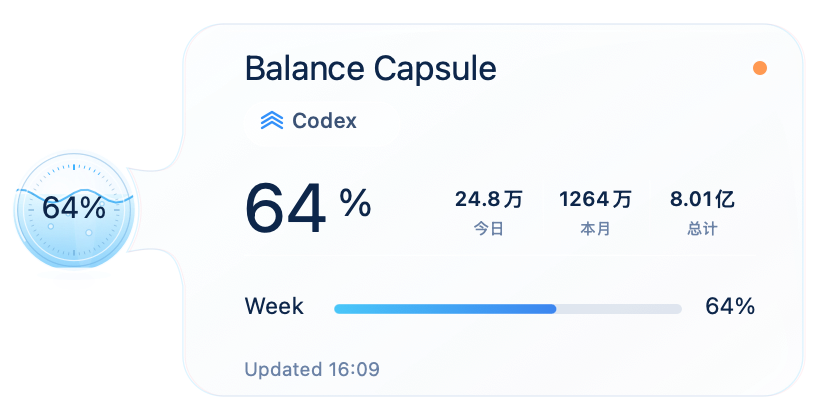

# Balance Capsule

一款精致、轻量、常驻桌面的 AI Agent 配额悬浮球。无需打开设置页，即可查看 Codex 与 Claude Code 的额度和刷新状态。


> Balance Capsule 目前仅支持 Codex 与 Claude Code。

## 下载

macOS 正式版和 Windows 预览版均可从 [Releases](https://github.com/Cchenshufen/Balance-Capsule/releases) 下载。

| 平台 | 系统要求 | 下载文件 |
| --- | --- | --- |
| macOS | macOS 26 或更高版本，仅 Apple Silicon | [下载 DMG](https://github.com/Cchenshufen/Balance-Capsule/releases/download/BalanceCapsule-mac.15/BalanceCapsule-mac.15-arm64.dmg) |
| Windows（预览版） | Windows 11 Build 22000 或更高，仅 x64 | [下载 EXE](https://github.com/Cchenshufen/Balance-Capsule/releases/download/BalanceCapsule-win.15/BalanceCapsule-win.15-x64.exe) · [ZIP 备用包](https://github.com/Cchenshufen/Balance-Capsule/releases/download/BalanceCapsule-win.15/BalanceCapsule-win.15-x64.zip) |

各平台的 Release 内均提供 SHA-256 校验文件。Windows 预览版已通过交叉编译和包完整性检查，Windows 11 实机启动与视觉对照仍待验证。

## 界面预览

以下为 macOS 版截图与动画，也是 Windows 版移植时的设计参考。

### 独立双来源悬浮球

选择“同时显示 Codex 和 Claude Code”后，会出现两个完全独立的悬浮球。Codex 保持蓝色体系，Claude Code 使用紫色体系；两个球可以分别拖动、悬停和展开。

<p align="center"></p>

### 独立液态玻璃详情

Codex 与 Claude Code 分别拥有自己的详情窗口，不再共用同一张合并卡片。每个面板只展示对应账号的数据、状态和额度窗口。

<p align="center"></p>

### Claude Code 额度阶段

Claude Code 会按照当前显示额度切换视觉阶段：紫色表示正常、洋红表示需要留意、玫红表示即将耗尽。Codex 原有配色保持不变。

<p align="center"></p>

### 液态悬停动画

<p align="center"></p>

### 单来源详情面板

<p align="center"></p>

## 视觉与交互效果

- 78px 常驻液态玻璃悬浮球，支持自由拖动与屏幕边缘吸附。
- 双来源模式使用两个独立的 78px 悬浮窗口，位置分别保存，互不覆盖。
- 鼠标滑入悬浮球自动展开详情，无需点击。
- 悬停 Codex 只打开 Codex 详情；悬停 Claude Code 只打开 Claude Code 详情，两个面板互相独立。
- 球体与详情面板通过连续液滴颈部自然衔接，包含液面摆动、气泡、刻度、扫光与柔和阴影。
- macOS 使用 AppKit、Core Animation 与 Core Image 实时绘制。Windows 使用 WPF 绘制对应的矢量球体、液位和展开动画，玻璃质感使用半透明渐变模拟。
- 所有主要界面均由代码生成，不使用效果图贴图代替交互界面。
- 详情面板提供标准、深色两种液态玻璃效果，并可在菜单中调节透明度。
- 双击任意悬浮球立即刷新；右键菜单和系统托盘也可刷新、切换显示来源或隐藏悬浮球。
- Codex 与 Claude Code 使用不同的矢量玻璃徽章，即使不看颜色也能辨认来源。

## 功能介绍

- 在“显示来源”菜单中选择仅 Codex、仅 Claude Code，或同时显示两者。
- 双来源模式下会创建两套独立悬浮球与详情窗口；每个球分别支持拖动、屏幕边缘吸附、悬停展开和位置记忆。
- Codex 保持蓝色视觉体系；Claude Code 使用紫色、洋红色、玫红色区分正常、提醒、紧张等额度阶段。
- Codex 显示当前账号的今日、本月、总计 Token 使用量，单位自动转换为“万 / 亿”。
- 按官方接口实际返回的额度显示。5 小时与一周额度同时可用时，悬浮球和菜单栏或托盘提示每 3 秒轮换，否则固定显示可用额度。
- Codex 与 Claude Code 数据独立读取，不混用账号或 Token 统计。
- 默认每 60 秒刷新；支持双击、右键菜单和托盘菜单立即刷新。
- 支持开机启动、显示/隐藏悬浮球、切换显示来源和退出应用。
- 单实例运行，重复启动不会创建第二个悬浮球。

## 使用方式

### macOS

1. 从 Releases 下载并打开最新的 macOS DMG。
2. 将 **Balance Capsule** 拖入 Applications。
3. 首次启动时，在 Finder 中右键应用并选择“打开”。本地发布包使用 ad-hoc 签名，未进行 Apple Developer ID 公证。
4. 保持 Codex 或 Claude Code 已登录；将鼠标滑到悬浮球上查看详情。

### Windows

退出托盘中正在运行的旧版，下载 EXE 并双击启动。EXE 自带运行时。也可完整解压 ZIP 后运行其中的 `BalanceCapsule.exe`。查看 Claude Code 额度时，可从托盘菜单安装桥接并在 Claude Code 中发送一条消息。[Windows 安装说明](docs/Balance-Capsule-Windows-安装说明.md)

### 通用操作

- **选择来源**：在系统菜单栏、Windows 托盘或悬浮球右键菜单中打开“显示来源”，选择单独显示或同时显示 Codex 和 Claude Code。
- **分别拖动**：双来源模式下，按住任意悬浮球即可单独移动；两个位置会分别保存。
- **查看详情**：鼠标进入某个悬浮球后，只展开该来源的详情；移出悬浮球和详情区域后自动收起。
- **立即刷新**：双击任意悬浮球，或在右键菜单、菜单栏、托盘中选择“立即刷新”。
- **切换玻璃效果**：在“详情玻璃效果”中选择标准液态毛玻璃或深色液态玻璃。
- **调节透明度**：在“详情透明度”中选择 70%、55%、40% 或 25%。
- **隐藏/显示**：菜单会根据当前状态显示“隐藏悬浮球”或“显示悬浮球”；双来源模式会同时隐藏或恢复两个球。
- **登录时启动**：勾选“登录时启动”，下次登录系统后自动运行。

## 工作原理

Codex 官方账号模式会在本机定位受信任的 Codex CLI 或桌面运行时，以 `app-server` 模式通过标准输入输出调用只读 RPC：

- `account/rateLimits/read`：读取官方配额窗口。
- `account/usage/read`：读取当前登录账号的 Token 使用统计。

Claude Code 模式通过官方 `statusLine` 数据读取其返回的额度信息，只保存百分比、重置时间和采集时间。个人 Claude Code 账号没有与 Codex 等价的官方账号 Token 汇总接口，因此不会使用本机会话日志估算或冒充官方总量。

## 隐私与安全

- 不读取或上传聊天正文、会话日志、浏览器 Cookie、浏览器登录状态或 Codex `auth.json`。
- 不读取 Claude 会话正文或 OAuth 登录令牌。
- 不包含遥测、广告、用户画像或分析 SDK。
- 本地仅保存悬浮球位置、选中数据源、显示状态和开机启动等非敏感设置。
- 不安装系统服务、驱动、根证书或浏览器扩展。

## 系统要求

### macOS

- macOS 26 或更高版本。
- Apple Silicon：M1、M2、M3、M4 或后续 arm64 芯片。
- 不支持 Intel Mac。

### Windows

- Windows 11 21H2（Build 22000）或更高版本。
- x64 处理器，下载包自带 .NET 桌面运行时。

## 从源码构建

macOS：

```bash
chmod +x scripts/build-macos.sh
scripts/build-macos.sh
```

构建产物位于 `artifacts/`。macOS 构建需要 Xcode Command Line Tools。

构建 Windows x64 版需要 .NET 8 SDK 和 Zsh。运行 `zsh scripts/build-windows.sh`，产物位于 `artifacts/windows/`。

## 免责声明与许可

额度信息以对应服务实际返回为准。本仓库当前未附加开源许可证；除非项目所有者另行授权，默认版权规则仍然适用。
